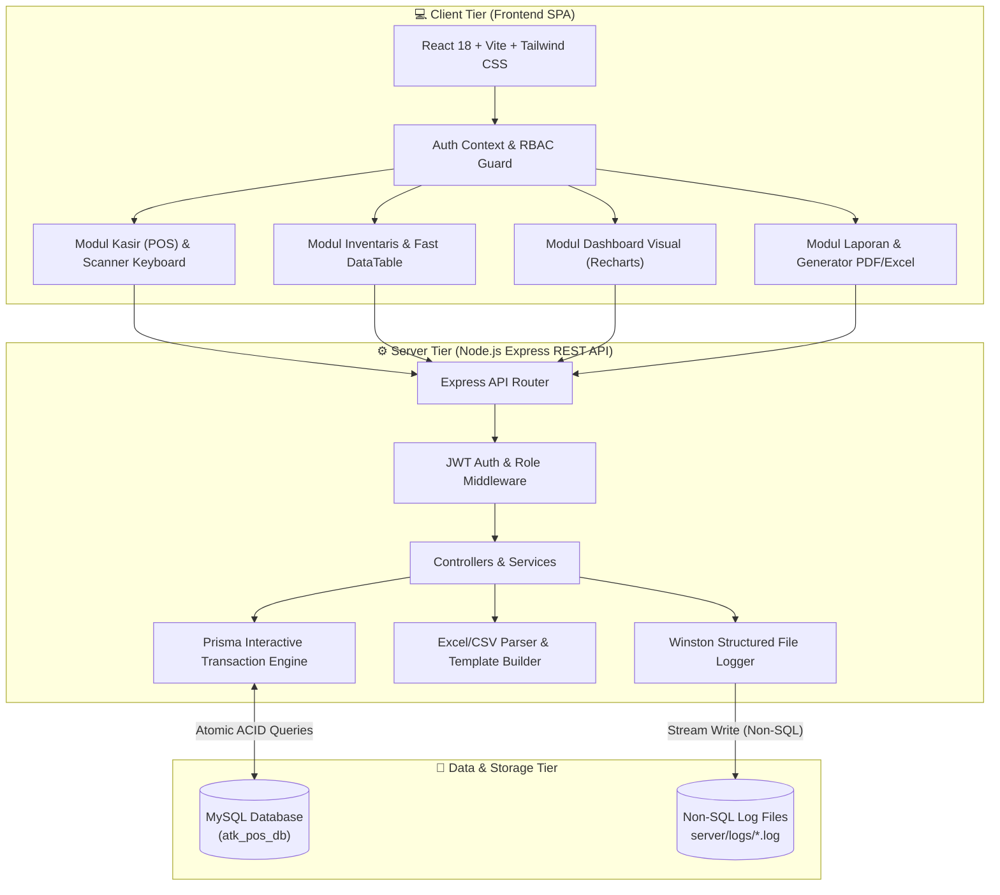
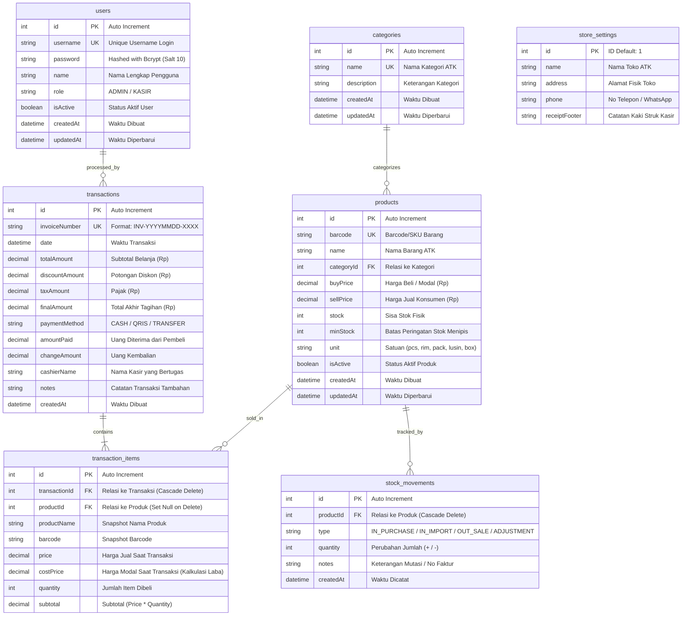
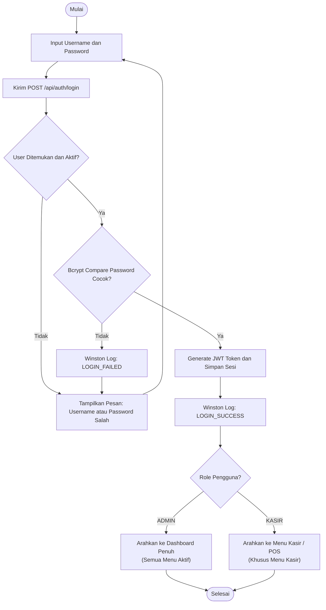
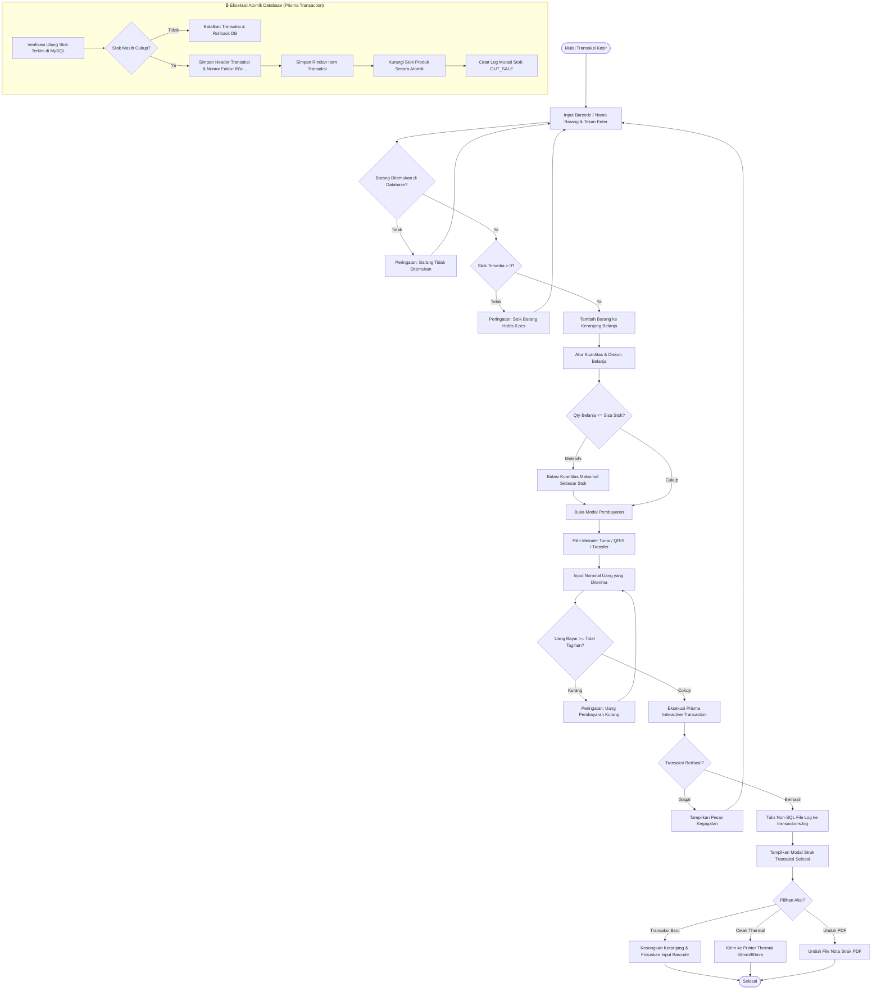
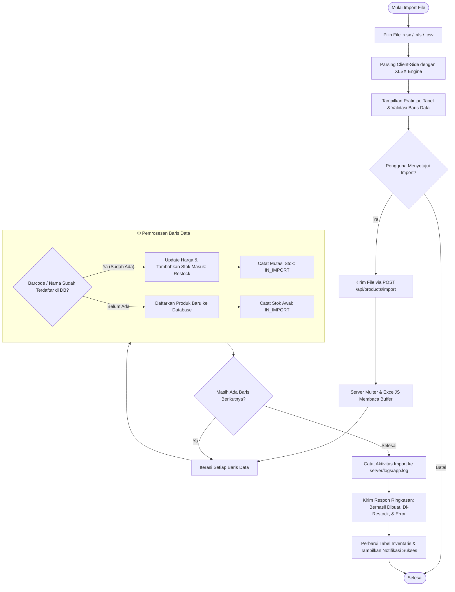
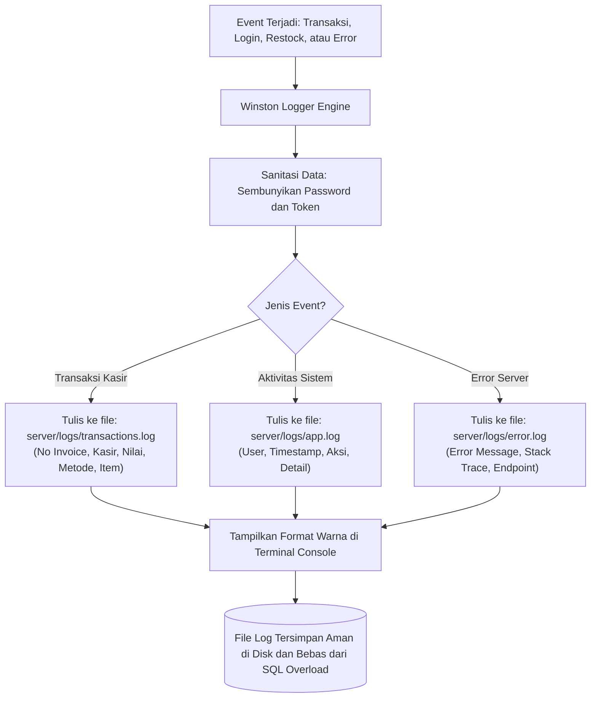

# DOKUMENTASI TEKNIS SISTEM WEB APP KASIR TOKO ATK
### (Point of Sale & Inventory Management System)

---

## 📑 DAFTAR ISI
1. [Informasi Umum Proyek](#1-informasi-umum-proyek)
2. [Arsitektur Sistem (System Architecture)](#2-arsitektur-sistem-system-architecture)
3. [Entity Relationship Diagram (ERD)](#3-entity-relationship-diagram-erd)
4. [Kamus Data & Spesifikasi Detail Tabel Database](#4-kamus-data--spesifikasi-detail-tabel-database)
5. [Matriks Hak Akses Pengguna (RBAC Matrix)](#5-matriks-hak-akses-pengguna-rbac-matrix)
6. [Flowchart Alur Bisnis Sistem](#6-flowchart-alur-bisnis-sistem)
   - 6.1. [Flowchart 1: Alur Otentikasi Login & Hak Akses](#61-flowchart-otentikasi-login--hak-akses)
   - 6.2. [Flowchart 2: Alur Transaksi Kasir (POS) & Validasi Stok Atomik](#62-flowchart-transaksi-kasir-pos--validasi-stok-atomik)
   - 6.3. [Flowchart 3: Alur Import & Restock Massal File Excel/CSV](#63-flowchart-import--restock-massal-file-excelcsv)
   - 6.4. [Flowchart 4: Alur Logging Non-SQL (Winston File Logger)](#64-flowchart-logging-non-sql-winston-file-logger)
7. [Spesifikasi Endpoint REST API](#7-spesifikasi-endpoint-rest-api)
8. [Mockup & Wireframe Antarmuka (UI Layout)](#8-mockup--wireframe-antarmuka-ui-layout)
   - 8.1. [Mockup Halaman Login](#81-mockup-halaman-login)
   - 8.2. [Mockup Halaman Kasir / POS](#82-mockup-halaman-kasir--pos)
   - 8.3. [Mockup Modal Pembayaran & Kalkulasi Kembalian](#83-mockup-modal-pembayaran--kalkulasi-kembalian)
   - 8.4. [Mockup Struk Kasir Thermal (58mm / 80mm)](#84-mockup-struk-kasir-thermal-58mm--80mm)
   - 8.5. [Mockup Halaman Inventaris & Fast DataTable](#85-mockup-halaman-inventaris--fast-datatable)
   - 8.6. [Mockup Halaman Dashboard Statistik & Grafik](#86-mockup-halaman-dashboard-statistik--grafik)
   - 8.7. [Mockup Halaman Laporan & Rekap Penjualan](#87-mockup-halaman-laporan--rekap-penjualan)
9. [Sistem Logging File Non-SQL & Audit Trail](#9-sistem-logging-file-non-sql--audit-trail)

---

## 1. Informasi Umum Proyek

* **Nama Aplikasi:** Sistem Web POS & Inventaris Toko ATK (Alat Tulis Kantor)
* **Teknologi Frontend:** React 18, Vite, Tailwind CSS, Recharts, Lucide React, Axios, jsPDF, jsPDF-AutoTable, XLSX
* **Teknologi Backend:** Node.js, Express.js, Prisma ORM, Multer, Winston File Logger, BcryptJS, JSON Web Token (JWT)
* **Database Engine:** MySQL Server (Koneksi & Transaksi Terkelola via Prisma ORM)
* **Sistem Logging:** File-Based Structured Logger (Non-SQL di folder `server/logs/`)
* **Pengguna Sistem:** Administrator Toko (Akses Penuh) & Kasir Toko (Akses Khusus Transaksi POS)

---

## 2. Arsitektur Sistem (System Architecture)



---

## 3. Entity Relationship Diagram (ERD)



---

## 4. Kamus Data & Spesifikasi Detail Tabel Database

### 4.1. Tabel `users` (Pengguna Sistem & Otentikasi)
* **Tujuan:** Menyimpan kredensial login, data identitas, dan peranan (*role*) pengguna sistem.
* **Keamanan Password:** Menggunakan algoritma **Bcrypt** (Salt rounds: 10). Password asli (`kunci123`) di-hash satu arah sehingga tidak dapat dibaca oleh pihak lain.

| No | Nama Kolom (Field) | Tipe Data | Constraint / Key | Null | Default | Keterangan & Fungsi Bisnis |
|:---|:---|:---|:---|:---|:---|:---|
| 1 | `id` | INT | PK, Auto Increment | NO | - | Identifier unik pengguna |
| 2 | `username` | VARCHAR(191) | UNIQUE, Indexed | NO | - | Username untuk login (misal: `admin`, `kasir`) |
| 3 | `password` | VARCHAR(191) | - | NO | - | **Hash Bcrypt** string keamanan password |
| 4 | `name` | VARCHAR(191) | - | NO | - | Nama lengkap kasir/admin |
| 5 | `role` | VARCHAR(191) | - | NO | `'KASIR'` | Tingkat hak akses: `'ADMIN'` atau `'KASIR'` |
| 6 | `isActive` | BOOLEAN | - | NO | `TRUE` | Status aktif user untuk login |
| 7 | `createdAt` | DATETIME | - | NO | `CURRENT_TIMESTAMP` | Waktu user didaftarkan |
| 8 | `updatedAt` | DATETIME | - | NO | On Update Current | Waktu terakhir user diubah |

---

### 4.2. Tabel `categories` (Kategori Produk ATK)
* **Tujuan:** Mengelompokkan barang ATK ke dalam klasifikasi yang teratur (Alat Tulis, Kertas & Buku, Map, dll.).

| No | Nama Kolom (Field) | Tipe Data | Constraint / Key | Null | Default | Keterangan & Fungsi Bisnis |
|:---|:---|:---|:---|:---|:---|:---|
| 1 | `id` | INT | PK, Auto Increment | NO | - | Identifier unik kategori |
| 2 | `name` | VARCHAR(191) | UNIQUE | NO | - | Nama kategori (misal: *Alat Tulis*) |
| 3 | `description` | VARCHAR(191) | - | YES | `NULL` | Keterangan deskripsi kategori barang |
| 4 | `createdAt` | DATETIME | - | NO | `CURRENT_TIMESTAMP` | Waktu kategori dibuat |
| 5 | `updatedAt` | DATETIME | - | NO | On Update Current | Waktu kategori diperbarui |

---

### 4.3. Tabel `products` (Katalog & Persediaan Barang ATK)
* **Tujuan:** Menyimpan data produk, kode barcode/SKU, harga modal, harga jual, stok fisik, dan batas peringatan stok menipis.

| No | Nama Kolom (Field) | Tipe Data | Constraint / Key | Null | Default | Keterangan & Fungsi Bisnis |
|:---|:---|:---|:---|:---|:---|:---|
| 1 | `id` | INT | PK, Auto Increment | NO | - | Identifier unik produk |
| 2 | `barcode` | VARCHAR(191) | UNIQUE, Indexed | YES | `NULL` | Barcode fisik atau kode SKU toko (misal: `8993175537012`) |
| 3 | `name` | VARCHAR(191) | Indexed | NO | - | Nama lengkap produk ATK |
| 4 | `categoryId` | INT | FK -> `categories.id` | YES | `NULL` | Relasi kategori (Set Null jika kategori dihapus) |
| 5 | `buyPrice` | DECIMAL(12,2) | - | NO | `0.00` | Harga beli / modal per satuan barang (Rp) |
| 6 | `sellPrice` | DECIMAL(12,2) | - | NO | `0.00` | Harga jual konsumen per satuan barang (Rp) |
| 7 | `stock` | INT | - | NO | `0` | Jumlah stok fisik barang yang tersedia saat ini |
| 8 | `minStock` | INT | - | NO | `5` | Batas minimal untuk memicu peringatan stok kritis |
| 9 | `unit` | VARCHAR(191) | - | NO | `'pcs'` | Satuan fisik barang (*pcs, pack, rim, lusin, box, roll*) |
| 10 | `isActive` | BOOLEAN | - | NO | `TRUE` | Status aktif barang di katalog kasir |
| 11 | `createdAt` | DATETIME | - | NO | `CURRENT_TIMESTAMP` | Waktu produk didaftarkan |
| 12 | `updatedAt` | DATETIME | - | NO | On Update Current | Waktu produk terakhir diedit |

---

### 4.4. Tabel `transactions` (Faktur Penjualan Kasir)
* **Tujuan:** Mencatat data induk transaksi pembayaran yang terjadi di kasir.

| No | Nama Kolom (Field) | Tipe Data | Constraint / Key | Null | Default | Keterangan & Fungsi Bisnis |
|:---|:---|:---|:---|:---|:---|:---|
| 1 | `id` | INT | PK, Auto Increment | NO | - | Identifier transaksi |
| 2 | `invoiceNumber` | VARCHAR(191) | UNIQUE, Indexed | NO | - | Nomor faktur otomatis: `INV-YYYYMMDD-XXXX` |
| 3 | `date` | DATETIME | Indexed | NO | `CURRENT_TIMESTAMP` | Waktu transaksi dilakukan |
| 4 | `totalAmount` | DECIMAL(12,2) | - | NO | `0.00` | Total subtotal belanja barang kotor (Rp) |
| 5 | `discountAmount`| DECIMAL(12,2) | - | NO | `0.00` | Potongan diskon harga yang diberikan (Rp) |
| 6 | `taxAmount` | DECIMAL(12,2) | - | NO | `0.00` | Besaran pajak transaksi (Rp) |
| 7 | `finalAmount` | DECIMAL(12,2) | - | NO | `0.00` | Total akhir tagihan yang wajib dibayar (Rp) |
| 8 | `paymentMethod` | VARCHAR(191) | - | NO | `'CASH'` | Metode bayar: `'CASH'`, `'QRIS'`, `'TRANSFER'` |
| 9 | `amountPaid` | DECIMAL(12,2) | - | NO | `0.00` | Jumlah uang fisik/transfer yang diserahkan |
| 10 | `changeAmount` | DECIMAL(12,2) | - | NO | `0.00` | Jumlah uang kembalian untuk pembeli |
| 11 | `cashierName` | VARCHAR(191) | - | NO | `'Kasir Toko'` | Nama petugas kasir yang melayani transaksi |
| 12 | `notes` | VARCHAR(191) | - | YES | `NULL` | Catatan transaksi tambahan / keterangan pembeli |
| 13 | `createdAt` | DATETIME | - | NO | `CURRENT_TIMESTAMP` | Waktu pencatatan database |

---

### 4.5. Tabel `transaction_items` (Rincian Barang dalam Transaksi)
* **Tujuan:** Menyimpan rincian setiap jenis barang, kuantitas, harga snapshot, dan kalkulasi profit per item.

| No | Nama Kolom (Field) | Tipe Data | Constraint / Key | Null | Default | Keterangan & Fungsi Bisnis |
|:---|:---|:---|:---|:---|:---|:---|
| 1 | `id` | INT | PK, Auto Increment | NO | - | Identifier item transaksi |
| 2 | `transactionId` | INT | FK -> `transactions.id` | NO | - | Relasi ke transaksi induk (Cascade Delete) |
| 3 | `productId` | INT | FK -> `products.id` | YES | `NULL` | Relasi produk (Set Null jika master produk dihapus) |
| 4 | `productName` | VARCHAR(191) | - | NO | - | *Snapshot* nama produk saat transaksi |
| 5 | `barcode` | VARCHAR(191) | - | YES | `NULL` | *Snapshot* barcode barang saat transaksi |
| 6 | `price` | DECIMAL(12,2) | - | NO | - | Harga jual satuan saat transaksi terjadi (Rp) |
| 7 | `costPrice` | DECIMAL(12,2) | - | NO | - | Harga modal satuan saat transaksi (untuk laba kotor) |
| 8 | `quantity` | INT | - | NO | - | Jumlah kuantitas item yang dibeli |
| 9 | `subtotal` | DECIMAL(12,2) | - | NO | - | Hasil perkalian `price * quantity` (Rp) |

---

### 4.6. Tabel `stock_movements` (Audit Mutasi Keluar/Masuk Stok)
* **Tujuan:** Buku besar riwayat keluar masuk stok untuk audit transparansi persediaan.

| No | Nama Kolom (Field) | Tipe Data | Constraint / Key | Null | Default | Keterangan & Fungsi Bisnis |
|:---|:---|:---|:---|:---|:---|:---|
| 1 | `id` | INT | PK, Auto Increment | NO | - | Identifier log mutasi |
| 2 | `productId` | INT | FK -> `products.id`, Indexed | NO | - | Produk yang mengalami perubahan stok |
| 3 | `type` | VARCHAR(191) | - | NO | - | Tipe: `IN_PURCHASE`, `IN_IMPORT`, `OUT_SALE`, `ADJUSTMENT` |
| 4 | `quantity` | INT | - | NO | - | Nilai perubahan (+ untuk masuk, - untuk keluar) |
| 5 | `notes` | VARCHAR(191) | - | YES | `NULL` | Alasan mutasi (No Invoice penjualan / Restock) |
| 6 | `createdAt` | DATETIME | - | NO | `CURRENT_TIMESTAMP` | Waktu mutasi terjadi |

---

### 4.7. Tabel `store_settings` (Konfigurasi & Profil Toko)
* **Tujuan:** Menyimpan identitas toko untuk kop struk belanja dan kop laporan cetak PDF resmi.

| No | Nama Kolom (Field) | Tipe Data | Constraint / Key | Null | Default | Keterangan & Fungsi Bisnis |
|:---|:---|:---|:---|:---|:---|:---|
| 1 | `id` | INT | PK | NO | `1` | ID tunggal konfigurasi |
| 2 | `name` | VARCHAR(191) | - | NO | `'Toko ATK Berkah Mandiri'` | Nama toko yang tercetak di struk & laporan |
| 3 | `address` | VARCHAR(191) | - | YES | `'Jl. Pendidikan No. 123'` | Alamat fisik toko ATK |
| 4 | `phone` | VARCHAR(191) | - | YES | `'081234567890'` | Nomor telepon / WhatsApp resmi toko |
| 5 | `receiptFooter` | TEXT | - | YES | `'Terima kasih...'` | Teks catatan kaki pada bagian bawah struk |

---

## 5. Matriks Hak Akses Pengguna (RBAC Matrix)

| Modul / Fitur Sistem | Role ADMIN | Role KASIR | Keterangan Hak Akses |
|:---|:---:|:---:|:---|
| **Login & Autentikasi** | ✅ Ya | ✅ Ya | Keduanya wajib login dengan username & password |
| **Menu Kasir (POS Interface)** | ✅ Ya | ✅ Ya | Kasir & Admin dapat melakukan transaksi belanja |
| **Input Barcode & Cari Barang** | ✅ Ya | ✅ Ya | Pencarian instan dan penambahan ke keranjang |
| **Proses Checkout & Bayar** | ✅ Ya | ✅ Ya | Menerima pembayaran Tunai, QRIS, dan Transfer |
| **Cetak Struk Thermal & PDF** | ✅ Ya | ✅ Ya | Mencetak nota transaksi belanja |
| **Menu Inventaris ATK** | ✅ Ya | ❌ Tidak | Kasir dibatasi, hanya Admin yang bisa akses inventaris |
| **Tambah & Edit Produk** | ✅ Ya | ❌ Tidak | Mengubah data barang dan harga jual/modal |
| **Hapus Produk ATK** | ✅ Ya | ❌ Tidak | Menghapus barang dari katalog |
| **Quick Restock Barang** | ✅ Ya | ❌ Tidak | Menambah stok barang masuk |
| **Download Template Excel/CSV** | ✅ Ya | ❌ Tidak | Unduh template standar import |
| **Import & Restock Massal File** | ✅ Ya | ❌ Tidak | Upload data produk via file Excel/CSV |
| **Export Inventaris ke Excel** | ✅ Ya | ❌ Tidak | Unduh master data barang |
| **Dashboard Grafik & Statistik** | ✅ Ya | ❌ Tidak | Visualisasi omset, chart tren, dan top produk |
| **Laporan Rekap Penjualan** | ✅ Ya | ❌ Tidak | Akses riwayat transaksi, margin profit, & laba |
| **Cetak Laporan PDF Resmi** | ✅ Ya | ❌ Tidak | Cetak PDF laporan lengkap dengan kop toko |
| **Export Laporan ke Excel** | ✅ Ya | ❌ Tidak | Unduh rekap transaksi untuk pembukuan |
| **Pengaturan Profil Toko** | ✅ Ya | ❌ Tidak | Mengubah nama toko, alamat, dan footer nota |

---

## 6. Flowchart Alur Bisnis Sistem

### 6.1. Flowchart Otentikasi Login & Hak Akses



---

### 6.2. Flowchart Transaksi Kasir (POS) & Validasi Stok Atomik



---

### 6.3. Flowchart Import & Restock Massal File Excel/CSV



---

### 6.4. Flowchart Logging Non-SQL (Winston File Logger)



---

## 7. Spesifikasi Endpoint REST API

| Method | Endpoint URL | Auth | Role | Deskripsi & Fungsi |
|:---|:---|:---:|:---:|:---|
| `POST` | `/api/auth/login` | ❌ Public | All | Otentikasi login username & password, mengembalikan token JWT |
| `GET` | `/api/auth/me` | 🔒 Bearer | All | Mengambil profil user yang sedang aktif dari token |
| `GET` | `/api/categories` | ❌ Public | All | Mengambil seluruh daftar kategori ATK beserta jumlah produk |
| `POST` | `/api/categories` | 🔒 Bearer | ADMIN | Membuat kategori ATK baru |
| `PUT` | `/api/categories/:id` | 🔒 Bearer | ADMIN | Memperbarui data kategori |
| `DELETE`| `/api/categories/:id` | 🔒 Bearer | ADMIN | Menghapus kategori produk |
| `GET` | `/api/products` | ❌ Public | All | Mengambil produk dengan filter keyword, barcode, kategori, dan pagination |
| `GET` | `/api/products/barcode/:barcode` | ❌ Public | All | Pencarian cepat produk berdasarkan barcode persis untuk POS |
| `POST` | `/api/products` | 🔒 Bearer | ADMIN | Menambahkan produk ATK baru ke katalog |
| `PUT` | `/api/products/:id` | 🔒 Bearer | ADMIN | Mengubah data barang, harga jual/modal, dan minimal stok |
| `POST` | `/api/products/:id/adjust-stock`| 🔒 Bearer | ADMIN | Quick restock / penyesuaian stok masuk/keluar dengan log mutasi |
| `DELETE`| `/api/products/:id` | 🔒 Bearer | ADMIN | Menghapus produk dari sistem |
| `GET` | `/api/products/template` | ❌ Public | ADMIN | Mengunduh file template Excel (.xlsx) siap isi |
| `GET` | `/api/products/template-csv` | ❌ Public | ADMIN | Mengunduh file template CSV (.csv) |
| `POST` | `/api/products/import` | 🔒 Bearer | ADMIN | Upload file Excel/CSV untuk mendaftarkan / me-restock barang massal |
| `GET` | `/api/products/export` | ❌ Public | ADMIN | Ekspor seluruh master inventaris ke Excel (.xlsx) atau CSV |
| `POST` | `/api/transactions` | ❌ Public | All | Proses checkout kasir atomik (`prisma.$transaction`), potong stok, & catat log |
| `GET` | `/api/transactions` | ❌ Public | ADMIN | Mengambil riwayat transaksi dengan filter rentang tanggal |
| `GET` | `/api/transactions/:id` | ❌ Public | All | Detail transaksi lengkap untuk cetak ulang nota |
| `GET` | `/api/reports/dashboard` | 🔒 Bearer | ADMIN | Mengambil data KPI metrik, tren penjualan 7 hari, top produk, dan kategori |
| `GET` | `/api/reports/sales` | 🔒 Bearer | ADMIN | Rekap penjualan detail beserta estimasi laba kotor |
| `GET` | `/api/reports/export/excel` | ❌ Public | ADMIN | Ekspor rekap laporan transaksi ke file Excel |
| `GET` | `/api/settings` | ❌ Public | All | Mengambil profil dan informasi toko ATK |
| `PUT` | `/api/settings` | 🔒 Bearer | ADMIN | Memperbarui nama toko, alamat, no telp, dan catatan footer struk |

---

## 8. Mockup & Wireframe Antarmuka (UI Layout)

### 8.1. Mockup Halaman Login

```
+-----------------------------------------------------------------------+
|                                                                       |
|                     [🏪 TOKO ATK BERKAH MANDIRI]                      |
|             Sistem Informasi Kasir & Inventaris Toko ATK              |
|                                                                       |
|             +-------------------------------------------+             |
|             |               MASUK KE SISTEM             |             |
|             | Silakan login dengan akun yang terdaftar  |             |
|             |                                           |             |
|             | Username:                                 |             |
|             | [👤 admin / kasir                       ] |             |
|             |                                           |             |
|             | Password:                                 |             |
|             | [🔒 ••••••••                            ] |             |
|             |                                           |             |
|             | [        MASUK SEKARANG       ➔ ]         |             |
|             |-------------------------------------------|             |
|             |         ⚡ AKSES CEPAT (AKUN DEMO)        |             |
|             | +-------------------+ +-----------------+ |             |
|             | | 🛡️ ADMIN          | | 🛒 KASIR        | |             |
|             | | Semua Akses Menu  | | Khusus Menu POS | |             |
|             | +-------------------+ +-----------------+ |             |
|             +-------------------------------------------+             |
|                                                                       |
+-----------------------------------------------------------------------+
```

---

### 8.2. Mockup Halaman Kasir / POS

```
+-----------------------------------------------------------------------------------------------------------------------+
| 🏪 Toko ATK Berkah Mandiri [POS ATK]                           🕒 Rabu, 07 Okt 2026 14:30 | 🛡️ Admin (ADMIN) [Keluar] |
+-----------------------------------------------------------------------------------------------------------------------+
| [Menu Sidebar] | [🔍 Ketik kode barcode / nama barang ATK lalu tekan Enter... ↵]                    [🔄 Refresh]      |
|                |------------------------------------------------------------------------------------------------------|
| 🛒 Kasir (POS) | [Semua Kategori] [Alat Tulis] [Kertas & Buku] [Map & Folder] [Peralatan Meja] [Pewarna & Gambar]     |
| 📦 Inventaris  |-------------------------------------------------------------------+----------------------------------|
| 📊 Dashboard   | +--------------------+ +--------------------+ +--------------------+ | 🛒 KERANJANG PESANAN (3 Item) |
| 📄 Laporan     | | 🏷️ Alat Tulis       | | 🏷️ Kertas & Buku   | | 🏷️ Peralatan Meja  | | Kasir: [Kasir Utama        ] |
| ⚙️ Pengaturan  | | Pulpen Standard    | | Kertas HVS A4 70gr | | Stapler Joyko HD10 | |--------------------------------|
|                | | AE7 0.5 Hitam      | | PaperOne (1 Rim)   | |                    | | Pulpen Standard AE7 Hitam      |
|                | | #8993175537012     | | #8998866100120     | | #8992753220119     | | 2 x Rp 3.000      [-] 2 [+] 🗑️|
|                | | Rp 3.000 / pcs     | | Rp 53.000 / rim    | | Rp 16.000 / pcs    | |                      Rp 6.000  |
|                | | [🟢 120 pcs]       | | [🟢 35 rim]        | | [🟢 20 pcs]        | | Kertas HVS A4 PaperOne (1 Rim) |
|                | +--------------------+ +--------------------+ +--------------------+ | 1 x Rp 53.000     [-] 1 [+] 🗑️|
|                | +--------------------+ +--------------------+ +--------------------+ |                     Rp 53.000  |
|                | | 🏷️ Kertas & Buku   | | 🏷️ Aksesoris       | | 🏷️ Alat Tulis       | |--------------------------------|
|                | | Buku Tulis Sinar   | | Sticky Notes Joyko | | Penghapus          | | Subtotal:            Rp 59.000 |
|                | | Dunia 38 Lembar    | | 3x3 Kuning         | | Faber-Castell Hitam| | [+ Tambah Diskon Potongan]     |
|                | | #8993988102018     | | #8992753550118     | | #8991389221039     | |--------------------------------|
|                | | Rp 40.000 / pack   | | Rp 7.000 / pad     | | Rp 3.500 / pcs     | | TOTAL TAGIHAN:       Rp 59.000 |
|                | | [🟢 25 pack]       | | [🟡 Menipis 4 pad] | | [🟢 45 pcs]        | | [  BAYAR & CETAK STRUK ➔  ]   |
+----------------+-------------------------------------------------------------------+----------------------------------+
```

---

### 8.3. Mockup Modal Pembayaran & Kalkulasi Kembalian

```
+-------------------------------------------------------------+
| SELESAIKAN PEMBAYARAN                                   [X] |
| Pilih metode dan input nominal bayar                        |
|-------------------------------------------------------------|
| +---------------------------------------------------------+ |
| | TOTAL TAGIHAN:                             Rp 59.000    | |
| | 3 Pcs Barang ATK                                        | |
| +---------------------------------------------------------+ |
|                                                             |
| Metode Pembayaran:                                          |
| +------------------+ +------------------+ +---------------+ |
| | 💵 [ TUNAI / CASH ]| | 📱 [   QRIS   ] | | 💳 [TRANSFER]| |
| +------------------+ +------------------+ +---------------+ |
|                                                             |
| Uang Diterima (Rp):                                         |
| [ Rp 100.000                                              ] |
|                                                             |
| Shortcut Pecahan:                                           |
| [Uang Pas] [Rp 60.000] [Rp 70.000] [Rp 100.000]             |
|                                                             |
| +---------------------------------------------------------+ |
| | UANG KEMBALIAN:                            Rp 41.000    | |
| +---------------------------------------------------------+ |
|                                                             |
| Catatan Transaksi:                                          |
| [Contoh: Pesanan Kantor Guru SMA 1                        ] |
|-------------------------------------------------------------|
| [ Batal ]                   [  ✓ KONFIRMASI & BAYAR  ]      |
+-------------------------------------------------------------+
```

---

### 8.4. Mockup Struk Kasir Thermal (58mm / 80mm)

```
========================================
       TOKO ATK BERKAH MANDIRI
    Jl. Pendidikan No. 123, Jakarta
           Telp: 0812-3456-7890
----------------------------------------
No. Faktur : INV-20261007-0001
Tanggal    : 07/10/2026 14:32
Kasir      : Kasir Utama
Pembayaran : CASH
----------------------------------------
Pulpen Standard AE7 0.5 Hitam
  2 x Rp 3.000                  Rp 6.000
Kertas HVS PaperOne A4 70gr (1 Rim)
  1 x Rp 53.000                Rp 53.000
----------------------------------------
Subtotal                       Rp 59.000
Diskon                               Rp 0
TOTAL AKHIR                    Rp 59.000
----------------------------------------
Tunai (CASH)                  Rp 100.000
Kembalian                      Rp 41.000
----------------------------------------
Terima kasih telah berbelanja di
Toko ATK Berkah Mandiri!
Barang yang dibeli tidak dapat ditukar.
========================================
```

---

### 8.5. Mockup Halaman Inventaris & Fast DataTable

```
+-----------------------------------------------------------------------------------------------------------------------+
| INVENTARIS & STOK ATK                                                                                                 |
| Kelola katalog barang, pantau persediaan, dan gunakan import/export data.                                             |
|                                                                                                                       |
| [+ Tambah Produk]  [📥 Import / Restock File]  [📊 Export Excel] [CSV]  [📄 Unduh Template]                           |
|-----------------------------------------------------------------------------------------------------------------------|
| [🔍 Cari nama barang ATK atau barcode...             ]  [Semua Kategori ▾]  [⚠️ Hanya Stok Menipis]                   |
|-----------------------------------------------------------------------------------------------------------------------|
| Barcode / Kode  | Nama Produk ATK          | Kategori     | Harga Beli  | Harga Jual  | Persediaan Stok | Aksi         |
|-----------------+--------------------------+--------------+-------------+-------------+-----------------+--------------|
| 8993175537012   | Pulpen Standard AE7 0.5  | Alat Tulis   | Rp 2.000    | Rp 3.000    | 🟢 120 pcs      | [➕] [✏️] [🗑️]|
| 8998866100120   | Kertas HVS A4 PaperOne   | Kertas & Buku| Rp 45.000   | Rp 53.000   | 🟢 35 rim       | [➕] [✏️] [🗑️]|
| 8992753550118   | Sticky Notes Joyko 3x3   | Aksesoris    | Rp 4.500    | Rp 7.000    | 🟡 Menipis 4 pad| [➕] [✏️] [🗑️]|
| 8992753550224   | Binder Clip No. 107      | Aksesoris    | Rp 4.000    | Rp 6.500    | 🟡 Menipis 3 box| [➕] [✏️] [🗑️]|
| 8991389330114   | Pensil Warna 12 Warna    | Pewarna      | Rp 28.000   | Rp 36.000   | 🟢 16 set       | [➕] [✏️] [🗑️]|
|-----------------------------------------------------------------------------------------------------------------------|
| Menampilkan 10 dari 20 data                                                [< Sebelumnya]  Halaman 1 dari 2  [Berikutnya >] |
+-----------------------------------------------------------------------------------------------------------------------+
```

---

### 8.6. Mockup Halaman Dashboard Statistik & Grafik

```
+-----------------------------------------------------------------------------------------------------------------------+
| DASHBOARD & STATISTIK ATK                                                                           [🔄 Refresh Data] |
| Ringkasan performa penjualan dan kesehatan persediaan toko.                                                           |
|                                                                                                                       |
| +--------------------+ +--------------------+ +--------------------+ +--------------------+                          |
| | OMSET HARI INI     | | OMSET BULAN INI    | | TOTAL PRODUK AKTIF | | STOK MENIPIS       |                          |
| | Rp 450.000         | | Rp 12.850.000      | | 20 Item            | | 2 Barang           |                          |
| | 8 Transaksi (+15%) | | 142 Transaksi      | | Terdaftar Aktif    | | ⚠️ Perlu Kulakan   |                          |
| +--------------------+ +--------------------+ +--------------------+ +--------------------+                          |
|                                                                                                                       |
| +-----------------------------------------------------+ +-----------------------------------------------------------+ |
| | 📈 GRAFIK TREN PENJUALAN 7 HARI TERAKHIR            | | 🍩 SEBARAN KATEGORI ATK                                   | |
| |                                                     | |                                                           | |
| |  Rp 600k |      /\                                  | |           (🍩 Donut Chart)                                | |
| |  Rp 400k |  /\ /  \   /\                            | |                                                           | |
| |  Rp 200k | /  V    \_/  \                           | |  [🟩 Alat Tulis: 6]     [🟦 Kertas & Buku: 4]             | |
| |     Rp 0 +----------------                          | |  [🟨 Peralatan Meja: 5] [🟪 Pewarna: 2]                   | |
| |          Sen Sel Rab Kam Jum Sab Min                | |  [🟧 Map/Folder: 2]     [🟥 Aksesoris: 2]                 | |
| +-----------------------------------------------------+ +-----------------------------------------------------------+ |
|                                                                                                                       |
| +-----------------------------------------------------+ +-----------------------------------------------------------+ |
| | 📊 PRODUK ATK TERLARIS (TOP SELLING)                | | ⚠️ PERINGATAN STOK MENIPIS                                | |
| |                                                     | |                                                           | |
| | Pulpen Standard AE7  ================== [48 pcs]    | | Sticky Notes Joyko 3x3        [🟡 4 pad]  [+ Restock]     | |
| | Kertas HVS A4 70gr   ==============     [22 rim]    | | Binder Clip No. 107           [🟡 3 box]  [+ Restock]     | |
| | Buku Sinar Dunia 38  ===========        [15 pack]   | |                                                           | |
| | Penghapus Faber C.   ========           [11 pcs]    | |                                                           | |
| +-----------------------------------------------------+ +-----------------------------------------------------------+ |
+-----------------------------------------------------------------------------------------------------------------------+
```

---

### 8.7. Mockup Halaman Laporan & Rekap Penjualan

```
+-----------------------------------------------------------------------------------------------------------------------+
| LAPORAN & REKAP PENJUALAN                                                                                             |
| Analisis riwayat transaksi, margin laba, dan cetak laporan resmi.                                                     |
|                                                                                                                       |
| [Hari Ini] [7 Hari] [Bulan Ini*] [Semua] [Kustom]       [📥 Excel (.xlsx)]  [📄 Cetak PDF Resmi]                      |
|-----------------------------------------------------------------------------------------------------------------------|
| +--------------------+ +--------------------+ +--------------------+ +--------------------+                          |
| | TOTAL OMSET        | | ESTIMASI LABA      | | TOTAL ITEM TERJUAL | | POTONGAN DISKON    |                          |
| | Rp 12.850.000      | | Rp 3.420.000       | | 320 Pcs            | | Rp 50.000          |                          |
| | 142 Transaksi      | | Margin: 26.6%      | | Fisik Keluar       | | Promo Diberikan    |                          |
| +--------------------+ +--------------------+ +--------------------+ +--------------------+                          |
|                                                                                                                       |
| [🔍 Cari nomor faktur / invoice atau kasir...                                                                       ] |
|-----------------------------------------------------------------------------------------------------------------------|
| No. Invoice       | Tanggal & Waktu  | Kasir        | Metode    | Item    | Total Akhir   | Aksi                      |
|-------------------+------------------+--------------+-----------+---------+---------------+---------------------------|
| INV-20261007-0001 | 07/10/2026 14:32 | Kasir Utama  | [ CASH ]  | 3 pcs   | Rp 59.000     | [👁️ Lihat Nota]           |
| INV-20261007-0002 | 07/10/2026 15:10 | Kasir Utama  | [ QRIS ]  | 5 pcs   | Rp 125.000    | [👁️ Lihat Nota]           |
| INV-20261006-0001 | 06/10/2026 10:15 | Administrator| [TRANSFER]| 10 pcs  | Rp 530.000    | [👁️ Lihat Nota]           |
+-----------------------------------------------------------------------------------------------------------------------+
```

---

## 9. Sistem Logging File Non-SQL & Audit Trail

Untuk menjaga database MySQL tetap ringan, seluruh riwayat transaksi, aktivitas pengguna, dan error aplikasi dicatat ke dalam file teks terstruktur di direktori **`server/logs/`**:

### 9.1. `server/logs/transactions.log`
Mencatat setiap transaksi penjualan yang sukses di kasir:
```text
[2026-10-07 14:32:15] TRANSAKSI BERHASIL: [INV-20261007-0001] | Kasir: "Kasir Utama" | Total: Rp 59.000 | Metode: CASH | Item (2 jenis): Pulpen Standard AE7 0.5 Hitam (2x), Kertas HVS PaperOne A4 70gr (1x) | Meta: {"level":"info"}
```

### 9.2. `server/logs/app.log`
Mencatat aktivitas otentikasi login, import data file, dan penyesuaian stok manual:
```text
[2026-10-07 14:00:10] [INFO]: [AKTIVITAS] User: admin [ADMIN] | Aksi: LOGIN_SUCCESS | Detail: {"name":"Administrator Toko"}
[2026-10-07 14:15:22] [INFO]: [AKTIVITAS] User: admin [ADMIN] | Aksi: ADJUST_STOCK | Detail: {"productId":1,"productName":"Pulpen Standard AE7","adjustedQty":50,"newStock":170}
[2026-10-07 14:20:45] [INFO]: [AKTIVITAS] User: admin [ADMIN] | Aksi: IMPORT_EXCEL_CSV | Detail: {"file":"Stok_Baru_Oktober.xlsx","createdCount":5,"restockedCount":12}
```

### 9.3. `server/logs/error.log`
Mencatat kesalahan teknis server dan *stack trace* untuk mempermudah pemeliharaan sistem:
```text
[2026-10-07 14:10:05] [ERROR]: [Error] POST /api/transactions - Stok untuk "Pulpen Standard" tidak mencukupi. Sisa stok: 2 pcs, permintaan: 10 pcs.
```
